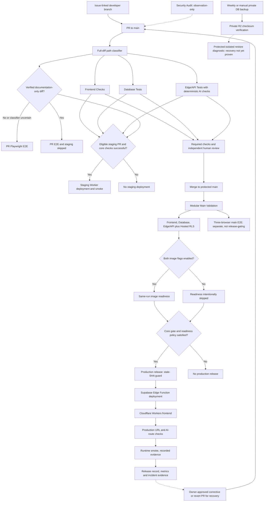

# Mori's Mix — CI/CD Pipeline

**Maintainer:** DevOps / Haresco  
**Work item:** [DEVOPS-12, issue #165](https://github.com/2ton-exe/moris-mix-ai/issues/165)  
**Configuration reference:** `main` at `04a82f8ab9fae3ae40301ba274f41bd8c2f52629`, checked 2026-11-21 (PHT)

This is the standalone pipeline document required by the course. It explains the configured delivery path and the evidence needed to say each stage actually worked. Live GitHub settings, workflow runs, deployment records and the current release decision supersede this dated inspection.

## Purpose, roles and evidence rules

DevOps owns the path from developer commit through validation, merge, release, runtime verification and operational recovery. Developers own application code and the tests of their components; the release owner coordinates the release/tag; the backend owner approves schema and data recovery decisions.

Keep these evidence states distinct: *configured → executed → passed → required → merged → deployed → runtime-verified*. A skipped step is not a passed test. A green workflow does not prove every optional test, feature journey or security audit passed.

## Pipeline diagram

The diagram describes the configured control flow, not an assertion that every path ran on every commit. Staging is independent of the approval gate: an eligible non-draft, same-repository PR can deploy to staging **before** a reviewer approves the PR. Staging environment authorization and effective Cloudflare token scope remain under security investigation in [#163](https://github.com/2ton-exe/moris-mix-ai/issues/163). Do not describe staging access restrictions as fully verified.

## PR validation and merge gates

**Caller:** [`modular-pr-validation.yml`](../../.github/workflows/modular-pr-validation.yml)  
**Trigger:** `pull_request` events `opened`, `synchronize`, `reopened` and `ready_for_review` targeting `main`.

| Stage | Why it exists / failure caught | When it executes | Blocking behavior |
| --- | --- | --- | --- |
| Complete-diff classifier | Avoid unnecessary work for verified prose-only diffs without silently omitting checks on uncertain diffs | Every eligible PR | Classifier failure defaults core jobs to full validation |
| Frontend Checks | Catch frontend lint, type/build, and relevant test failures | Every PR; lighter branch for verified docs-only | Required merge context |
| Database Tests | Catch schema/migration and database test failures | Every PR; lighter branch for verified docs-only | Required merge context |
| Edge/API Tests | Catch backend, auth/API contract and deterministic AI/schema/evaluation failures | Every PR; lighter branch for verified docs-only | Required merge context |
| Playwright browser E2E | Catch integrated browser journey regressions | Non-documentation PRs unless skipped by defined classifier policy | Additional evidence; **not one of the three required contexts** |
| Staging deployment and smoke | Detect build/configuration and public frontend/API/database smoke failures on a staging Worker | Only after successful core checks for a non-draft, same-repository, non-Dependabot PR not on the docs-only skip path | Conditional job; not an independently required merge context |

The required contexts recorded in repository guidance are `Modular Frontend / Frontend Checks`, `Modular Database / Database Tests` and `Modular Edge/API / Edge/API Tests`. The protected-main policy also requires human review and resolved conversations; code-owner review is applicable where enforced. Verify actual live ruleset settings before claiming enforcement on a later date. A CodeRabbit review or PR Secretary status is informational, not a human approval.

PR validation cannot call the production deployment workflow. Normal deterministic AI tests do not require a live paid Gemini request, provider availability or production Gemini credentials.

## Main validation, deployment and verification

**Caller:** [`modular-main.yml`](../../.github/workflows/modular-main.yml)  
**Release implementation:** [`reusable-production.yml`](../../.github/workflows/reusable-production.yml)

| Stage | Purpose / failure caught | Trigger or dependency | Gate |
| --- | --- | --- | --- |
| Main frontend, database and Edge/API | Recheck merged source rather than relying only on PR checks | Push to `main` or permitted dispatch | All must succeed for production |
| Hosted RLS integration | Validate relevant hosted database authorization assumptions | Required inside main Edge/API reusable validation | Included in release-blocking Edge/API result |
| Main Playwright E2E (Chromium, Firefox, WebKit) | Detect browser journey regressions | Runs separately on main | **Not listed in production `needs`**; its failure may occur after deployment |
| Image readiness | Check current production upload-signing prerequisites and origin when both image and cleanup flags are enabled | `VITE_RECIPE_IMAGES == 'true'` **and** `RECIPE_IMAGE_CLEANUP_ENABLED == 'true'` | Must succeed when required; otherwise may be intentionally skipped |
| Production source guard | Prevent stale main revisions from overwriting newer deployments | Production job on `main` only | Blocks an outdated revision |
| Supabase deployment | Deploy explicitly configured backend functions | After passing release dependencies | Failed deployment blocks subsequent steps |
| Cloudflare deployment | Publish the frontend static assets | After backend deployment prerequisites | Failed deployment blocks verification |
| Production verification | Check configured deployed URL, provider-free AI route behavior, frontend HTML/JS and public demo API/database smoke | After deployment | Results and artifacts provide runtime evidence |

The release also requires that the frontend project actually exists. The Cloudflare production path is serialized with production-backup capture through the `cloudflare-production` concurrency group. The old `ci.yml` production caller was retired; `modular-main.yml` is the production caller.

The unconditional Supabase targets in the inspected configuration include `recipes`, `extract-recipe`, `generate-recipe` and `recipe-image-attach`. Image upload/download and cleanup functions depend on their corresponding feature flags. `account-export` is disabled in the production workflow; do not claim it was deployed or tested because the main workflow succeeded.

**Important limits:** The smoke checks do not establish every authenticated CRUD, image, extraction or Chef journey, and provider-free AI-route checks do not establish successful live Gemini generation. Main E2E is not a deployment prerequisite. Production database migrations are **not** automatically applied by the ordinary main release. [PR #154](https://github.com/2ton-exe/moris-mix-ai/pull/154), a separate production migration proposal, was open/unmergeable at this inspection; database recovery prerequisites are tracked in [#155](https://github.com/2ton-exe/moris-mix-ai/issues/155).

### Recent bounded execution evidence

[Modular Main Validation #44859832569](https://github.com/2ton-exe/moris-mix-ai/actions/runs/44859832569) ran at main SHA `04a82f8ab9fae3ae40301ba274f41bd8c2f52629` after PR #243. Its job results include successful frontend, database, Edge/API, Hosted RLS, Chromium/Firefox/WebKit, image readiness and production deployment. This is **deployment-job evidence**; examine its deployment/URL/smoke step summaries and artifacts before making a claim about the exact released revision or a future rollback target. The release owner has not yet designated this SHA as the final release or known-good rollback target for #165.

## Security, credentials and AI-provider behavior

[`security-audit.yml`](../../.github/workflows/security-audit.yml) runs observational pnpm (root/frontend) and Deno dependency audits on selected dependency/configuration PR changes or manual dispatch. Its audit steps permit `continue-on-error`. Thus a green audit workflow is not proof of zero vulnerabilities. Findings require owner triage; this workflow is not a required merge or production release gate.

GitHub-native secret scanning/push protection were previously operator-confirmed, but the coverage is limited to supported patterns and needs live settings evidence for later claims. Credentials belong in GitHub/provider environment secret stores, never source, test fixtures, issues, PR bodies or public logs.

Current [#163 security work](https://github.com/2ton-exe/moris-mix-ai/issues/163) includes action pinning and checkout hardening, but staging authorization, effective privileged-token scope, remaining actions and the final security gating decision are unresolved. A workflow's `environment:` declaration does not by itself prove effective environment protection.

Routine AI validation stays deterministic and provider-independent. Any separately authorized live-provider test must control cost and must not block unrelated PRs or main deployments because Gemini is unavailable. Provider settings, billing and quota evidence belong to [#162](https://github.com/2ton-exe/moris-mix-ai/issues/162), not an assumption in this pipeline document.

## Backup, recovery and incident boundaries

[`database-backup.yml`](../../.github/workflows/database-backup.yml) supports scheduled weekly and manual main-only logical PostgreSQL backup to private R2. [Backup #4](https://github.com/2ton-exe/moris-mix-ai/actions/runs/42227611036) provides archive upload, remote size, re-download and SHA-256 evidence; a later scheduled execution is documented in issue #163. These prove backup/transfer handling, **not** restorable production data.

[#159](https://github.com/2ton-exe/moris-mix-ai/issues/159) remains open because protected, isolated PostgreSQL restoration has not completed successfully. Current permission/GRANT diagnostics do not prove the exact failing SQL statement or its root cause. Do not infer database rollback ability from application redeployment or backup checksums. Database schema/data recovery requires the backend owner's separate review and an evidenced recovery path.

**Application rollback procedure:** see [`deployment-runbook.md`](deployment-runbook.md), Section 12. The preferred *proposed, not yet executed* path is a focused corrective or revert PR from current `main`, independent review and required checks, merge, a new main deployment, and verification of the specific recovered behavior. A revert creates a **new commit** and does not necessarily reconstruct a byte-identical old release after intervening changes. Stale-SHA manual dispatch is not the rollback plan.

A successful controlled rollback must also return production to the release-owner-approved intended state and pass deployment/runtime verification again. Neither application rollback nor the teammate-runbook rehearsal has been executed under #165.

## Evidence locations

- [Pipeline metrics](pipeline-metrics.md): bounded run populations, outcomes, timings and measured optimization limitations.
- [Optimization log](optimization-log.md): baseline and comparable results for tested changes.
- [Incident log](incident-log.md): genuine delivery incidents, failure attempts and qualified recovery evidence; never invent an incident.
- [Database backup/restore](database-backup-restore.md): #159-specific experiments and recovery limitations.
- [Deployment runbook](deployment-runbook.md): operator procedures and the untested application rollback plan.
- [GitHub Actions](https://github.com/2ton-exe/moris-mix-ai/actions): source SHAs, job/step conclusions, artifacts and exact deployment runs.

**Still pending for #165:** release/rollback target designation; real controlled application rollback/redeployment; smoke and affected-feature verification after rollback; return to intended release; teammate-runbook rehearsal; and final evidence-based reconciliation after those events.
