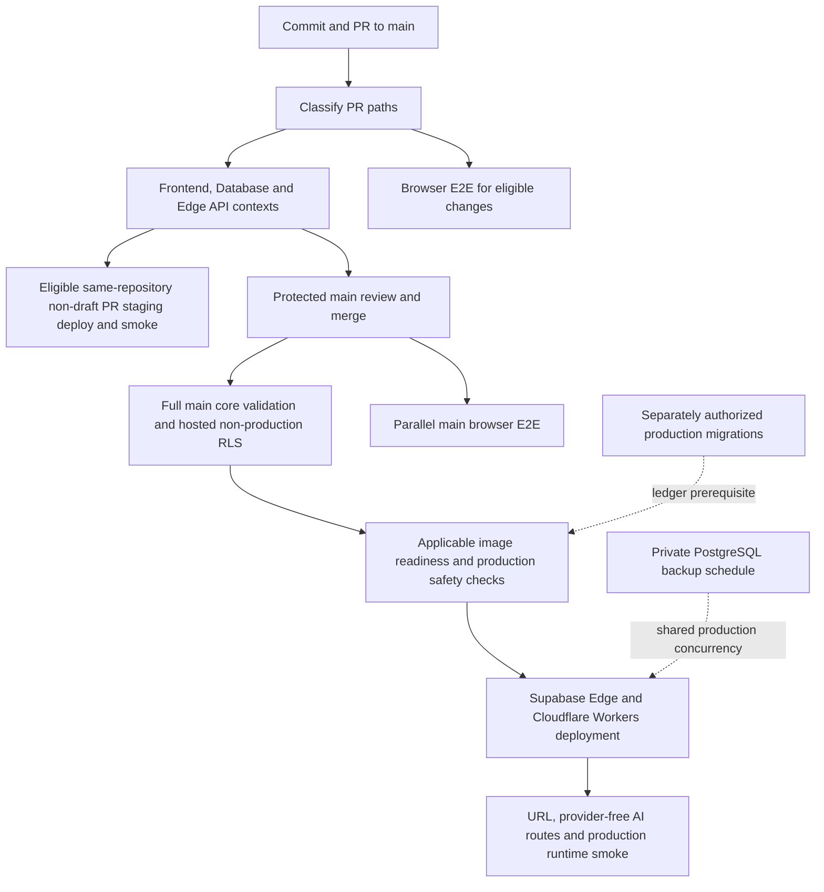

# Mori’s Mix DevOps evidence handoff

**For Yuan Paulo Sebastian M. Belen** · **27 November 2026 PHT (UTC+08:00)** · **CSP221A / BSCS 4B / 2ton.exe**

Use the integration text below for the final brief. D1–D5 are **partial** at this checkpoint. The published release is `v1.0.0` at `c49a840`, with a changelog and matching production delivery. Finalized R2 object disposition and target-specific application acceptance remain unverified. The rollback rehearsal and current CI evidence can be cited now. Yuan owns final synthesis, non-DevOps evidence and approval.

## 1. Sources and production acceptance baseline

| Source | Version and use |
| --- | --- |
| `endterm_format.md` | Authoritative header and §§1–10 for the brief. Supplied file SHA-256 `0ccd5f3c6501513b214234ad3a447b0ad12674ffb1d628398fd795713b87098a`. The Canvas instructions §§5, 7–9 govern the separate course delivery/recovery evidence. [Course resource](https://csp221a.vercel.app/) |
| Supplied `final-brief.md` | 27 November provisional draft, SHA-256 `b1bf13a6eb2c71ffae52d476211bb6af18885fc4abe5dcee093ad7b10147b9ee`. This matches the Markdown recorded for Yuan’s reviewed revision `3677bce219a5ce6ad1be78bfb4b3e152859e1366`. PR #293 is open and draft at `8090b85f84cdb0fc3a8dfc4c780a695a96447186`. Its companion register already corrects the figure status. The brief text still contains the generic “Missing PA screenshots” wording. The approval record applies to that reviewed revision and recorded corrections. [Brief](https://github.com/2ton-exe/moris-mix-ai/blob/8090b85f84cdb0fc3a8dfc4c780a695a96447186/docs/submission/final-brief.md) · [D1–D5 and gap register](https://github.com/2ton-exe/moris-mix-ai/blob/8090b85f84cdb0fc3a8dfc4c780a695a96447186/docs/submission/outstanding-confirmations.md#separate-devops-dependency) · [Approval/provenance record](https://github.com/2ton-exe/moris-mix-ai/blob/8090b85f84cdb0fc3a8dfc4c780a695a96447186/docs/submission/assets/clarification-record-20261127.json) |
| Repository and operational source | Current `main` inspected at `c49a8406a535d9b3475634f4f3c6ff998223e246`, including the actual workflow callers, cleanup configuration, protected-main rules, deployment job and relevant issue records. PR #293’s base/head and the local source checkpoints `d329285` and `40b5e10` remain separate identities. [Main commit](https://github.com/2ton-exe/moris-mix-ai/commit/c49a8406a535d9b3475634f4f3c6ff998223e246) · [PR #293](https://github.com/2ton-exe/moris-mix-ai/pull/293) · [Workflows at main](https://github.com/2ton-exe/moris-mix-ai/tree/c49a8406a535d9b3475634f4f3c6ff998223e246/.github/workflows) |
| Production acceptance report | Inspected the supplied `MORIS_MIX_PRODUCTION_ACCEPTANCE_2026-11-27.docx`, SHA-256 `2cd8eb69c1604ec132a5a023980517b5b4d6607db67c0e88021b25fcc4e57952`. It contains the later R2 addendum and both figures. [Original DOCX](https://github.com/2ton-exe/moris-mix-ai/blob/8090b85f84cdb0fc3a8dfc4c780a695a96447186/docs/submission/assets/PA-20261127.docx) · [Readable report and evidence index](https://github.com/2ton-exe/moris-mix-ai/blob/8090b85f84cdb0fc3a8dfc4c780a695a96447186/docs/submission/assets/PA-20261127.md#evidence-index-and-gap-updates) |

### Embedded figures

| Evidence-index entry and caption | Verified DOCX provenance |
| --- | --- |
| **DUR-01 panel evidence**, 18:10 PHT on 27 November. Figure 1, “QA witness recipe reopened after the production deployment.” [PA-20261127-DUR-01-post-deployment.png](https://raw.githubusercontent.com/2ton-exe/moris-mix-ai/8090b85f84cdb0fc3a8dfc4c780a695a96447186/docs/submission/assets/PA-20261127-DUR-01-post-deployment.png) | `rId9 → word/media/image1.png`, SHA-256 `2d59a66e0801ba6650064337e26286f37fe5b4adafce04f81851cb6e39b00cc3` |
| **DUR-01 cleanup evidence**, 18:15 PHT on 27 November. Figure 2, “Former QA witness page after deletion.” [PA-20261127-DUR-01-cleanup.png](https://raw.githubusercontent.com/2ton-exe/moris-mix-ai/8090b85f84cdb0fc3a8dfc4c780a695a96447186/docs/submission/assets/PA-20261127-DUR-01-cleanup.png) | `rId10 → word/media/image2.png`, SHA-256 `484f69043bb1fd70091808dd71afcf10fbf718bd45622d8c76e95dd039948ba0`. The figure shows the former recipe page after application deletion. Exact R2 object absence belongs to D2. |

The report began at 17:34:55 PHT in production with an existing QA session. Initial release `5cad4b8be8c04e2fcec4cccc4266ddcdcbcb10e7` used Cloudflare version `272002ff-7f1c-4a92-a598-70a6a820694f`. Follow-up `05c9b322cecb61ed0344f9c4ed479170afb7a5c7` deployed at 17:59:48 PHT as version `732d8c18-3f8e-442c-a4ac-c3eefbdd6cdf`, serving the same asset names. Its runbook-only change supplied the deployment boundary for DUR-01. All three user-facing AI submissions occurred on the initial release. Automatic provider-attempt count and independent per-function runtime source identities were unmeasured. [Initial main run 45962613287](https://github.com/2ton-exe/moris-mix-ai/actions/runs/45962613287) · [Follow-up main run 45977892706](https://github.com/2ton-exe/moris-mix-ai/actions/runs/45977892706)

| Scenario | Recorded result |
| --- | --- |
| AUTH-01 | Pass for reused-session authenticated access. Fresh credential entry remained outside the observed flow. |
| CRUD-01 | Pass for creation, reopen, edit, second reopen and deletion of a synthetic recipe. |
| DUR-01 | Pass for readback of the same witness over the two named deployments. Witness deletion was subsequently recorded, including the two embedded figures. |
| AI-EX-01 | Pass for extraction, editable preview, edit, explicit save and reopen. |
| AI-CH-01 | Failed end-to-end at Instructions step 4 → Recipe inspiration. A preview appeared. Parent selection, save, lineage and reopen remained unverified. |
| AI-REV-282 | Failed end-to-end after rejection of the oil quantity change. The report establishes #282 feature presence through the merge ancestor `7918d99c7370103dd30334ef720334b2ed3aacb0` and exercised UI. No linked copy was accepted. [PR #282](https://github.com/2ton-exe/moris-mix-ai/pull/282) |
| R2-01 | Pass for app upload, replacement, signed-in readback and removal from normal app access. |
| R2-02 | Partial. The report records queued entries with zero attempts and no completion/error. A teammate reported both exact objects present after app removal. |

## 2. D1–D5 evidence matrix

**Status key.** Verified means a retained artifact or authorized direct observation supports the stated scope. Operator-reported means an attributable account supplies the finding. Missing means the required evidence was not found. Pending identifies a specific unresolved decision, access requirement or action. Dependency completion is tracked separately.

| Dependency / completion | Finding and status | Date, environment and revision | Remaining action and owner |
| --- | --- | --- | --- |
| **D1 · Partial · Designated release** | **Verified** GitHub first returned zero tags and zero releases. The final refresh found published, non-draft, non-prerelease **`v1.0.0`**, release ID `460790549`, published by `DaeSaster`. Direct tag ref resolves to `c49a8406a535d9b3475634f4f3c6ff998223e246`. The release notes are the initial-release changelog and link the exact production workflow. They exclude draft #293 and record database recovery limits. The notes page loaded anonymously. [Published release and changelog](https://github.com/2ton-exe/moris-mix-ai/releases/tag/v1.0.0) · [Tags](https://github.com/2ton-exe/moris-mix-ai/tags) | 27 Nov PHT, empty at about 23:36, published 23:41:56 and verified 23:48:56. GitHub `main` and tag both at `c49a840`. | Yuan can cite the tag, exact SHA and changelog now. DevOps and app owners retain the independent function provenance and release-specific acceptance gaps below. |
| **D1 · Current frontend** | **Verified** run `46024556206`, job `140593658184`, checked out main `c49a840`; Workers deployment logged version `caf9c875-5107-4230-81e4-d7d6d36e6477`. URL, AI-route and runtime smoke passed and the whole workflow succeeded. Public About and exact JS/CSS assets returned HTTP 200, matching the job’s asset names `index-DkVAbpYd.js` and `index-lfTsqv1L.css`. [Run](https://github.com/2ton-exe/moris-mix-ai/actions/runs/46024556206) · [Job](https://github.com/2ton-exe/moris-mix-ai/actions/runs/46024556206/job/140593658184) · [Public About](https://moris-mix-ai.diofelgwenharesco.workers.dev/about) | 27 Nov, Worker version 23:27:23 PHT, smoke recorded 23:27:27, run completed 23:28:36, public check about 23:36 PHT. Production / Cloudflare Workers, subsequently tagged `v1.0.0`. | DevOps rechecks the mapping at designation. Direct provider traffic-allocation metadata for this version was unavailable here. |
| **D1 · Current backend** | **Verified** the same production job logged seven Edge deployments from the release checkout: `recipes`, `extract-recipe`, `generate-recipe`, `recipe-image-attach`, `recipe-image-download-url`, `recipe-image-upload-cleanup`, `recipe-image-upload-url`. Account export, finalized-object cleanup and its availability probe were skipped. Public bundle and job identified the same production Supabase origin. **Missing** independent current provider function versions/source correspondence. Both connected identities were denied production project metadata. [Deployment job](https://github.com/2ton-exe/moris-mix-ai/actions/runs/46024556206/job/140593658184) | 27 Nov, deploy steps 23:26:51–23:27:13 PHT, production Supabase, job source `c49a840`. | Authorized Supabase operator supplies active per-function versions, timestamps and deployment-to-source linkage, including any retained earlier version of the skipped functions. |
| **D1 · Acceptance applicability** | **Verified** #308 merged as `66ccff12a63f9640303475b4877bc51acd9dee67` and was deployed in run `46021982543`. Its repairs are present in the latest deployment’s ancestry. Later work changed AI quota/context/revision, editor behavior, image handlers and two migrations beyond PA. C49 deployment smoke had provider-free route checks. **Pending** targeted app evidence at the designated revision. [PA-to-repair comparison](https://github.com/2ton-exe/moris-mix-ai/compare/05c9b322cecb61ed0344f9c4ed479170afb7a5c7...66ccff12a63f9640303475b4877bc51acd9dee67) · [#308](https://github.com/2ton-exe/moris-mix-ai/pull/308) · [Repair release](https://github.com/2ton-exe/moris-mix-ai/actions/runs/46021982543) | 27 Nov, historical PA `5cad4b8`/ `05c9b32`, repair local `40b5e10`, later production `66ccff1` then `c49a840`. | Yuan and app owners validate the specific claimed journeys for `v1.0.0`. DevOps records exact environment and deployment identity. |
| **D2 · Partial · Exact objects** | **Verified** retained report contains the queue checkpoint and records both entries queued with zero attempts, no completion and no recorded error. **Operator-reported** an authorized teammate inspected the exact production keys: A present at 18:36:22, B at 18:36:36. Both were left in place. Report author’s earlier R2 access was denied. **Missing** later queue rows, processing and exact-key checks. Supabase project access was denied in this handoff, and no authorized later R2 lookup was available. [PA R2 addendum](https://github.com/2ton-exe/moris-mix-ai/blob/8090b85f84cdb0fc3a8dfc4c780a695a96447186/docs/submission/assets/PA-20261127.md#teammate-report-on-r2-cleanup) | 27 Nov, historical 18:08–18:36 PHT, production PA; new access check around 23:36 PHT. | DevOps/Supabase operator reads only the two mapped queue rows. Cloudflare R2 operator checks both exact objects under known-good read access, before and after any approved cleanup. Publish aliases A and B only. |
| **D2 · Scheduling / invocation** | **Verified** current main contains a separate finalized workflow, GitHub workflow ID `432690894` is marked active, and its all-event run API reported zero runs. Configured cron is UTC minutes 07/22/37/52, guarded on `main` and `RECIPE_IMAGE_FINAL_CLEANUP_ENABLED=true`. The latest production deploy and probe skipped it. **Missing** effective flag/authorization metadata and any invocation via another mechanism. The exact GitHub variable endpoint returned 404 at 23:47 PHT. This response leaves both an unset variable and insufficient visibility possible. PA’s ACTIVE-function listing is historical. Latest upload-cleanup run `46008231998` executed its own invoke step successfully and serves the staging-upload lifecycle. Zero attempts alone does not identify why the objects remained. [Final workflow](https://github.com/2ton-exe/moris-mix-ai/actions/workflows/recipe-image-final-cleanup.yml) · [Upload-cleanup run](https://github.com/2ton-exe/moris-mix-ai/actions/runs/46008231998) · [Activation runbook](https://github.com/2ton-exe/moris-mix-ai/blob/c49a8406a535d9b3475634f4f3c6ff998223e246/docs/devops/deployment-runbook.md#enable-finalized-image-cleanup) | 27 Nov, upload schedule run created 21:34:08 PHT at `d329285`; final workflow inventory about 23:38 PHT at current main. | DevOps and backend owner check effective scheduler, trigger logs and queue health read-only. Follow the bounded authorization plan below if work remains. |
| **D3 · Partial · Application recovery** | **Verified** #307 forward deploy `87e320a`, #309 reviewed the inverse and merged `02a6c67` at 23:06:41. The standalone run failed at the stale guard before provider writes. Its inverse rode #308 descendant `66ccff1` into production (Worker `4406aef4-4424-49d9-b46f-22c7ac21991a`), and smoke passed at 23:13:52, **7m 11s** from rollback merge. **Operator-reported** original CTA restored. Exact browser time and capture were unavailable in the recovery record. #165 closed for the scoped rehearsal. [#165](https://github.com/2ton-exe/moris-mix-ai/issues/165) · [Guard failure](https://github.com/2ton-exe/moris-mix-ai/actions/runs/46021942517) · [Recovery run](https://github.com/2ton-exe/moris-mix-ai/actions/runs/46021982543) · [Runbook](https://github.com/2ton-exe/moris-mix-ai/blob/c49a8406a535d9b3475634f4f3c6ff998223e246/docs/devops/deployment-runbook.md#12-application-recovery-and-rollback) | 27 Nov PHT, production, `87e320a` → `02a6c67` (blocked) → `66ccff1`, documented in `c49a840`. | DevOps supplies the scoped Demo Day recovery evidence. Teammate walkthrough and separate release-owner final-state record were deferred internal items. Recovery was a reviewed Git revert and new deployment. No provider-history rollback, downtime interval, schema reversal or data restoration was measured. |
| **D3 · Backup / isolated restore / schema policy** | **Verified** private logical backup production and R2 re-download/checksum in run `45083275244`; hosted isolated synthetic replay `45941712593` at #294 head `0262e0d`. **Operator-reported** retained local synthetic logical-dump round trip matched five table counts, migration versions and seven FK mappings plus Auth trigger probe; original archive/log unavailable. Production Backups #4 and #7 failed data replay. #294 closed unmerged. #159 closed on narrowed scope with protected production-archive restore and retention verification deferred. #155 retired as not planned; #154 closed unmerged. Dated ledger check at `d329285` recorded 28 repo and 28 applied versions with zero differences. Current production prerequisite checks passed; schema release uses separate database/release authorization. [#159](https://github.com/2ton-exe/moris-mix-ai/issues/159) · [Backup](https://github.com/2ton-exe/moris-mix-ai/actions/runs/45083275244) · [Synthetic replay](https://github.com/2ton-exe/moris-mix-ai/actions/runs/45941712593) · [#155](https://github.com/2ton-exe/moris-mix-ai/issues/155) | Backup run 23 Nov PHT at `a371825`; restore/ledger disposition 27 Nov PHT; production, disposable local and hosted synthetic environments as specified. | Ramos/DevOps retain the approved deferral and exact limits. A separately authorized future recovery claim requires one actual production archive restored to a disposable target with integrity, ledger/schema, aggregate and isolation evidence, plus target cleanup. |
| **D3 · Delivery metrics / documents** | **Verified** active default-branch ruleset requires one approval, Code Owners, thread resolution and all three modular validation contexts. Canonical pipeline guide, metrics, optimization, incident and deploy/rollback records are available. See current diagram and metrics below. [Ruleset](https://github.com/2ton-exe/moris-mix-ai/ruleset/24943171) · [#164](https://github.com/2ton-exe/moris-mix-ai/issues/164) | 27 Nov GitHub rules readback at 23:36 PHT, source `c49a840`; historical metrics 7–17 Nov UTC. | DevOps provides these retained links and the static diagram for the panel. |
| **D3 · Uninterrupted recording** | **Pending** local `final.mp4` and original-named recording `Screen Recording 2026-11-27 224422.mp4` have identical SHA-256 `07ca03a0e1badb13e1f57d34bb431a628f07a9bfdcbdc484ed073303c1fc1de9`. **Verified** local candidate is 21:31 with audio. Sampled frames show the original live CTA (0:00), source diff and local tests (1:45), #307 PR (3:00), PR checks/staging (10:00), Yuan’s displayed review and merge prompt (12:00), successful main pipeline (17:00) and changed live CTA (19:00). Full continuity and sharing suitability remain pending. The merge screen displays a commit email field. Review the complete file for content exposure before sharing. The #307 PR, review and run records establish the delivery event and serve as supporting links. Targeted Drive video search found no matching file. [#307](https://github.com/2ton-exe/moris-mix-ai/pull/307) · [Forward run](https://github.com/2ton-exe/moris-mix-ai/actions/runs/46017219840) | 27 Nov PHT, local original candidate completed 22:44:22 according to file metadata. #307 production `87e320a`. | DevOps checks full continuity, scope and content exposure, then obtains an approved panel-playable URL and verifies playback as reviewer. |
| **D4 · Partial · Provider and costs** | **Verified** retained 27 Nov provider audit records Gemini API restriction, no application restriction, Google project Free with no linked billing and model quota **15 RPM / 250,000 input TPM / 500 RPD** for Gemini 3.5 Flash Lite. **Operator-reported** Haresco linked the issued key to production Supabase, corroborated by name-only/timestamp history (last observed replacement 15 Nov 08:25:43 PHT). `gemini-3.5-flash-lite` is the source default and the audit found model override names absent. **Missing** current runtime identity/overrides, comprehensive quota consumers, account spend caps/actual charges and current non-Google plan/invoice readbacks. Historic Supabase Free is documented. Workers/R2 and GitHub account-specific plan, billing and spend-control details remain unverified. [Merged provider audit #297](https://github.com/2ton-exe/moris-mix-ai/pull/297) · [Audit detail](https://github.com/2ton-exe/moris-mix-ai/blob/c49a8406a535d9b3475634f4f3c6ff998223e246/docs/devops/ai-aware-ci.md#consolidated-production-provider-audit--2026-11-27-pht) · [Supabase pricing](https://supabase.com/pricing) · [Workers pricing](https://developers.cloudflare.com/workers/platform/pricing/) · [R2 pricing](https://developers.cloudflare.com/r2/pricing/) | 27 Nov PHT audit against `7e5260b`, after historical 15 and 20 Nov observations. Current deployment `c49a840` is a newer checkpoint. | Account owners give dated plan, cost, quota, spend-setting and non-secret runtime readbacks. Record whether each control exists, applies and is enforced. No provider call is needed solely to verify billing. |
| **D4 · Quota, audience and content use** | **Verified** source has per-account quota logic and optional shared attempt admission. Early audit found optional settings and database prerequisites absent. Later 28/28 ledger includes both Nov 20 quota migrations, so the catalog observation is historical. Effective optional settings and enforcement remain **Pending**. Google’s terms describe professional/business developer use and age/available-region limits, require paid services for client availability in EEA/Switzerland/UK and describe unpaid-data improvement/human review subject to regional terms. The app sends notes and selected recipe context to Gemini. **Missing** approved audience/geography/content policy and evidence of enforceable controls. [#155 ledger](https://github.com/2ton-exe/moris-mix-ai/issues/155) · [AI contract](https://github.com/2ton-exe/moris-mix-ai/blob/c49a8406a535d9b3475634f4f3c6ff998223e246/docs/api/ai-integration.md) · [Gemini terms](https://aistudio.google.com/docs/terms) · [Available regions](https://aistudio.google.com/docs/available-regions) | Terms effective 23 Mar 2026, checked 27 Nov. Early/later production evidence at `7e5260b` / `d329285`. | Product owner, Yuan and Sioson confirm intended users, regions, eligible use and handling of private content. DevOps verifies any approved resulting controls, plan and feature settings. |
| **D4 · Environments / secrets / staging authority** | **Verified** protected release/backup split from #291, restored release mapping via #303, protected production deployment from #303 and current workflow, canonical staging deploy and smoke after the cutover. **Operator-reported** replacement staging token entry at 14:21:08 and dated GitHub-native scan/push-protection settings, zero alerts visible within supported patterns. Direct GitHub readback at 23:48 PHT returned `refs/pull/*/merge` for staging and `main` for release/backup. All three showed admin bypass disabled and branch-policy protection. The automatic staging path can precede review for eligible same-repo non-draft PRs. Cutover run’s overall E2E failed. **Pending** direct replacement-token audit attribution, dedicated backup PAT pooler permission (recorded 403), a successful backup using the replacement path, and authorized legacy credential disposition. No current universal history, log or artifact coverage is established. [#163](https://github.com/2ton-exe/moris-mix-ai/issues/163) · [#291](https://github.com/2ton-exe/moris-mix-ai/pull/291) · [#303](https://github.com/2ton-exe/moris-mix-ai/pull/303) · [Security checks](https://github.com/2ton-exe/moris-mix-ai/blob/c49a8406a535d9b3475634f4f3c6ff998223e246/docs/devops/security-checks.md) | 27 Nov PHT staging on run `45951106396`; production recovery run `45997105147`; current protected deployment `46024556206`. Native scanning is dated operator evidence. | DevOps/admin provides redacted environment approvers/branch rules, secret-name timestamps and provider authority limits, plus approved disposition of legacy and backup gaps. |
| **D4 · Actual retention** | **Verified** private weekly logical backup and distinct app-image lifecycle designs. Backup target is four weekly and three monthly generations. Actual R2 lifecycle and retention compliance lacked access (403). Image contract defines bounded retry for finalized keys and hourly rechecks for ambiguous late copies. Upload reconciliation records have a documented 30-day retention policy. **Missing** actual retained generations, final-object queue disposition and deployed retention periods for provider/operational records. [Backup policy](https://github.com/2ton-exe/moris-mix-ai/blob/c49a8406a535d9b3475634f4f3c6ff998223e246/docs/devops/database-backup-restore.md) · [Image contract](https://github.com/2ton-exe/moris-mix-ai/blob/c49a8406a535d9b3475634f4f3c6ff998223e246/docs/api/recipe-images.md#finalized-object-cleanup) | 27 Nov, current source and retained production records. | Storage/Supabase and DevOps owners supply redacted lifecycle readbacks and actual sample retention where accessible. Product/AI owners document provider input/output treatment. |
| **D5 · Partial · Artifact access** | **Verified** unauthenticated GET returned actual content for the exact public board reconstruction, both named PNGs and the latest production job page. The v1.0.0 page and release notes also loaded anonymously. The FINAL DOCUMENT’s anonymous text export returned Mori’s Mix content and the reviewer-index heading, confirming a readable export at that checkpoint. Original Projects board and the runtime artifact download returned 404 anonymously. [Board reconstruction](https://github.com/2ton-exe/moris-mix-ai/blob/8090b85f84cdb0fc3a8dfc4c780a695a96447186/docs/submission/board-evidence.md) · [Original Projects board](https://github.com/orgs/2ton-exe/projects/2) · [FINAL DOCUMENT](https://docs.google.com/document/d/1USkQIcd6oCz7vO2sAsE2ssJcLbs-OOlsEqgfmDamqcI/edit?tab=t.0) | 27 Nov, 23:36–23:38 PHT, anonymous HTTP checks. Draft reconstruction `8090b85`; current delivery `c49a840`. | DevOps supplies the readable equivalents below. DevOps/board or recording owner verifies exact artifact access and documents original-history gaps. Yuan checks the exact final tab/PDF using a panel-equivalent account. |
| **D5 · Attributable assistance** | **Verified** CodeRabbit-marked review/summaries on cited DevOps PRs and marked recipe-image documentation passages, plus a retained #159 Codex execution account for synthetic restore evidence. **Operator-reported** team-level Codex/OpenCode/CodeRabbit review use in #293 and Haresco’s local #164 Codex handoff describing metrics reconciliation work. **Missing** output-level provenance for any other adopted DevOps workflow/script/template changes and borrowed snippets. Details below. [Disclosure register](https://github.com/2ton-exe/moris-mix-ai/blob/8090b85f84cdb0fc3a8dfc4c780a695a96447186/docs/submission/external-work-disclosure.md) · [#159](https://github.com/2ton-exe/moris-mix-ai/issues/159) · [#164](https://github.com/2ton-exe/moris-mix-ai/issues/164) | 18–27 Nov 2026 PHT, source/PR and attributable operator records. | Haresco confirms rows below, identifies exact adopted files or hunks and review/CI, and records licenses/credit or the bounded unknown. Yuan carries the supported results into §8. |

### Current delivery configuration and measurements

This diagram follows the current PR and main callers. The active ruleset readback lists **Modular Frontend / Frontend Checks**, **Modular Database / Database Tests** and **Modular Edge/API / Edge/API Tests**. Main E2E runs alongside the release path. Production waits on core checks, hosted non-production RLS and applicable image readiness, with credential, stale-revision and migration prerequisite checks. The release then deploys Supabase functions and Workers, verifies the HTTPS origin, probes AI routes without a provider call, and performs runtime smoke. Production database schema changes have a separately authorized path. [PR caller](https://github.com/2ton-exe/moris-mix-ai/blob/c49a8406a535d9b3475634f4f3c6ff998223e246/.github/workflows/modular-pr-validation.yml) · [Main caller](https://github.com/2ton-exe/moris-mix-ai/blob/c49a8406a535d9b3475634f4f3c6ff998223e246/.github/workflows/modular-main.yml) · [Pipeline guide and diagram](https://github.com/2ton-exe/moris-mix-ai/blob/c49a8406a535d9b3475634f4f3c6ff998223e246/docs/devops/PIPELINE.md#pipeline-diagram)

- **Frozen 7–17 November UTC cohort:** PR runs 196/231 successful (84.8%) and main pushes 42/51 (82.4%). Attempt success was 196/232 PR and 42/56 main pushes. Six manual runs are separate. The aligned PR job-span means are 37.13 s for 23 docs-only runs and 360.46 s for 39 three-browser-generation runs. There were 48 successful production jobs out of 62 selected production attempts. The exact-SHA merge-to-smoke join found 43/51 successful endpoints (median 172 s), with eight unavailable. Job span, deploy steps and merge-to-smoke measure different boundaries. [Metrics §15](https://github.com/2ton-exe/moris-mix-ai/blob/c49a8406a535d9b3475634f4f3c6ff998223e246/docs/devops/pipeline-metrics.md#15-final-sprint-4-measurement-window-and-supplemental-main-push-evidence)
- **Controlled measurements:** Docs-only PR wall clock 91 s (one run) → 37 s (three runs), 54 s shorter. Chromium E2E job duration approximately 92 s (three historical observations) → 86.8 s (five attempts of a single change). Runner variance and small samples limit generalization. [Optimization log](https://github.com/2ton-exe/moris-mix-ai/blob/c49a8406a535d9b3475634f4f3c6ff998223e246/docs/devops/optimization-log.md)
- **Incidents outside that cohort:** On 27 November, the protected-release credential mapping incident took 1h 20m 33s from the blocked credential step to smoke after correction. Public production checks continued to pass. The later overlapping-merge recovery took 7m 11s from rollback merge to smoke. Both intervals describe delivery recovery. [Incident log](https://github.com/2ton-exe/moris-mix-ai/blob/c49a8406a535d9b3475634f4f3c6ff998223e246/docs/devops/incident-log.md) · [#163](https://github.com/2ton-exe/moris-mix-ai/issues/163) · [#165](https://github.com/2ton-exe/moris-mix-ai/issues/165)

### Reviewer-readable equivalents and assistance details

| Restricted source or disclosure | What the panel can use now | Residual limit |
| --- | --- | --- |
| Runtime/AI smoke ZIPs `15211871852` / `15211786762` and provider console | Current production job page and D1 row above provide sanitized job outcomes, public build filenames, Worker version and timestamps. The Google provider audit gives a dated, value-free summary. | Actual ZIP download and provider dashboards may require an eligible viewer. No panel credential test was performed. |
| Original Projects board | Exact #293 reconstruction contains 78 sprint-labeled issues and 159 issue/PR pairs from the recorded capture at `7e5260b`. Public issue/PR histories support individual rows. [Board evidence](https://github.com/2ton-exe/moris-mix-ai/blob/8090b85f84cdb0fc3a8dfc4c780a695a96447186/docs/submission/board-evidence.md) | Historical moves, archived cards, iterations and board-only history remain unavailable. A permissioned export or project-owner-provided redacted history would cover that gap. |
| Continuous challenge video | #307 and exact run show the staged and production delivery trail. Provide the approved original recording/playback URL when verified. | Text, screenshots and separate GitHub runs cannot substitute for the continuous recording. |
| CodeRabbit review and documentation | #297 and #310 preserve generated review summaries on the provider/rollback documentation and human/CI review trail. Marked passages in the recipe-image contract entered repository docs. #152/#160 preserve related review evidence. [#297](https://github.com/2ton-exe/moris-mix-ai/pull/297) · [#310](https://github.com/2ton-exe/moris-mix-ai/pull/310) · [#152](https://github.com/2ton-exe/moris-mix-ai/pull/152) · [#160](https://github.com/2ton-exe/moris-mix-ai/pull/160) | Markers prove the displayed output. Adoption of individual suggestions into operational code needs file/hunk attribution. |
| Codex DevOps analysis and verification | Haresco’s local `Moris_Mix_164_Final_Metrics_Evidence_2026-11-18/README.md` assigns Codex run-ledger reconciliation and documentation support. The adopted repository metrics/incident records have linked source runs. #159 attributes local synthetic restore checks to retained Codex evidence. This handoff itself used Codex for read-only collection and Markdown drafting. [#164 methodology](https://github.com/2ton-exe/moris-mix-ai/issues/164#issuecomment-6981417219) · [#159](https://github.com/2ton-exe/moris-mix-ai/issues/159) | The #164 assignment alone does not identify authored lines, the #159 temporary original log is unavailable, and team-wide tool declarations do not identify individual usage. |
| Templates and upstream components | The live GitHub PR template and versioned upstream Actions are inspectable inputs. The course pipeline stage list informed the requirements. The repository workflows and retained exact-run evidence show how the configured stages were reviewed and tested. [PR template](https://github.com/2ton-exe/moris-mix-ai/blob/c49a8406a535d9b3475634f4f3c6ff998223e246/.github/pull_request_template.md) · [Workflows](https://github.com/2ton-exe/moris-mix-ai/tree/c49a8406a535d9b3475634f4f3c6ff998223e246/.github/workflows) | Additional borrowed templates, copied snippets and individually adopted assistant output remain unconfirmed. |

## 3. Text ready for the Endterm brief

| Required location | Copy-ready wording |
| --- | --- |
| **Header · Evidence links** | Final release [v1.0.0 and changelog](https://github.com/2ton-exe/moris-mix-ai/releases/tag/v1.0.0). Production checkout `c49a8406a535d9b3475634f4f3c6ff998223e246`, Workers version `caf9c875-5107-4230-81e4-d7d6d36e6477`. [Repository](https://github.com/2ton-exe/moris-mix-ai) · [Production](https://moris-mix-ai.diofelgwenharesco.workers.dev) · [Deployment](https://github.com/2ton-exe/moris-mix-ai/actions/runs/46024556206) |
| **1 Product status & architecture** | Workers serves the frontend, Supabase Edge Functions own application data and Gemini requests, Supabase PostgreSQL persists recipes, and signed access serves private R2 image bytes. The 27 November acceptance passed session-reused access, CRUD, extraction/save/reopen, recorded cross-deployment persistence and app-level image handling. Chef and note-driven revision failed their recorded end-to-end journeys. [Production acceptance](https://github.com/2ton-exe/moris-mix-ai/blob/8090b85f84cdb0fc3a8dfc4c780a695a96447186/docs/submission/assets/PA-20261127.md) |
| **2 Technology & dependency disclosure** | GitHub Actions deploys Supabase Edge Functions and Cloudflare Workers from protected main. The dated Gemini audit recorded Free with no linked billing and listed Gemini 3.5 Flash Lite limits of 15 RPM, 250,000 input TPM and 500 RPD. The source model default is `gemini-3.5-flash-lite`. Effective runtime overrides, other service charges and any configured spend limit remain unverified. [Provider audit](https://github.com/2ton-exe/moris-mix-ai/pull/297) |
| **3 Data model, API & user workflow** | In PA-20261127 the synthetic recipe was created, opened, edited and deleted in production. A separate witness survived the follow-up deployment and was deleted afterward. Figures 1 and 2 are embedded and available as extracted originals. [Report and figure index](https://github.com/2ton-exe/moris-mix-ai/blob/8090b85f84cdb0fc3a8dfc4c780a695a96447186/docs/submission/assets/PA-20261127.md#evidence-index-and-gap-updates) |
| **4 AI feature: design, output processing & evidence** | Three production app submissions on the PA release yielded one end-to-end extraction success and two end-to-end failures in Chef and note-driven revision. Provider attempt counts were unobserved. Required CI runs deterministic Edge/API checks, and production route smoke verifies route behavior without calling the provider. Scheduled live-provider smoke is deferred. [PA](https://github.com/2ton-exe/moris-mix-ai/blob/8090b85f84cdb0fc3a8dfc4c780a695a96447186/docs/submission/assets/PA-20261127.md) · [AI-aware CI](https://github.com/2ton-exe/moris-mix-ai/blob/c49a8406a535d9b3475634f4f3c6ff998223e246/docs/devops/ai-aware-ci.md) |
| **5 Security, data protection & reliability** | Production release credentials are injected through a protected environment and Gemini’s key is stored server-side. Native scanning covers supported patterns. The PA report records two finalized image entries queued with zero attempts and an authorized teammate reported both objects still present. Current workflow has separate finalized cleanup wiring, with no run observed. Effective provider eligibility controls and later physical absence remain open. [Security record](https://github.com/2ton-exe/moris-mix-ai/issues/163) · [Image contract](https://github.com/2ton-exe/moris-mix-ai/blob/c49a8406a535d9b3475634f4f3c6ff998223e246/docs/api/recipe-images.md#finalized-object-cleanup) |
| **6 Testing: report actual counts and results** | At `c49a840`, CI logged 1,015 frontend tests passed across 64 files, 557 deterministic Edge/API passed, 0 failed and 6 ignored, and a separate non-production hosted RLS invocation with 204 passed and 0 failed. Nine browser shards and production smoke passed. Earlier PA results remain dated to `5cad4b8` and `05c9b32`. #308 repairs were deployed, with the two earlier PA failures awaiting targeted end-to-end production verification. [CI](https://github.com/2ton-exe/moris-mix-ai/actions/runs/46024556206) · [#308](https://github.com/2ton-exe/moris-mix-ai/pull/308) |
| **7 Engineering process & CI/CD** | Protected main requires one approval, Code Owner review, thread resolution and three core checks. Eligible PRs can deploy staging. Main validates, deploys and performs production smoke. Controlled docs-only PR timing improved from 91 s to 37 s (one before, three after); 7–17 November UTC success was 196/231 PR and 42/51 main-push runs. The live CTA recovery passed smoke 7m 11s after the rollback merge. Synthetic restore proof exists; production-archive recovery remains unverified. Continuous challenge recording URL pending. [Pipeline](https://github.com/2ton-exe/moris-mix-ai/blob/c49a8406a535d9b3475634f4f3c6ff998223e246/docs/devops/PIPELINE.md) · [Metrics](https://github.com/2ton-exe/moris-mix-ai/blob/c49a8406a535d9b3475634f4f3c6ff998223e246/docs/devops/pipeline-metrics.md) · [Recovery](https://github.com/2ton-exe/moris-mix-ai/issues/165) |
| **8 Contribution and external-work disclosure** | Diofel Gwen F. Haresco owns pipeline, deployment, optimization and recovery evidence. CodeRabbit contributed recorded review/summaries and marked documentation passages. Codex supported DevOps evidence reconciliation and documented synthetic restore work. Linked human review and retained runs establish validation for the identified outputs. Additional per-output assistance or third-party attribution awaits owner confirmation. [Disclosure](https://github.com/2ton-exe/moris-mix-ai/blob/8090b85f84cdb0fc3a8dfc4c780a695a96447186/docs/submission/external-work-disclosure.md) · [#159](https://github.com/2ton-exe/moris-mix-ai/issues/159) |
| **9 Current limitations and final status** | The production acceptance establishes its recorded passes and two AI journey failures. Both DUR-01 figures are supplied. Release v1.0.0 is tagged and deployed. Target-specific app acceptance, exact-object cleanup, effective provider policy evidence and the panel-playable recording remain open. The protected production-archive restore was deferred under the approved narrower backup scope. [Remaining facts](https://github.com/2ton-exe/moris-mix-ai/blob/8090b85f84cdb0fc3a8dfc4c780a695a96447186/docs/submission/outstanding-confirmations.md) |
| **10 Reviewer evidence index** | Link the [exact production job](https://github.com/2ton-exe/moris-mix-ai/actions/runs/46024556206/job/140593658184), [acceptance and figures](https://github.com/2ton-exe/moris-mix-ai/blob/8090b85f84cdb0fc3a8dfc4c780a695a96447186/docs/submission/assets/PA-20261127.md#evidence-index-and-gap-updates), [pipeline diagram](https://github.com/2ton-exe/moris-mix-ai/blob/c49a8406a535d9b3475634f4f3c6ff998223e246/docs/devops/PIPELINE.md#pipeline-diagram), [metrics](https://github.com/2ton-exe/moris-mix-ai/blob/c49a8406a535d9b3475634f4f3c6ff998223e246/docs/devops/pipeline-metrics.md), [incident log](https://github.com/2ton-exe/moris-mix-ai/blob/c49a8406a535d9b3475634f4f3c6ff998223e246/docs/devops/incident-log.md), [backup and restore](https://github.com/2ton-exe/moris-mix-ai/issues/159), and [board reconstruction](https://github.com/2ton-exe/moris-mix-ai/blob/8090b85f84cdb0fc3a8dfc4c780a695a96447186/docs/submission/board-evidence.md). Link [v1.0.0 and changelog](https://github.com/2ton-exe/moris-mix-ai/releases/tag/v1.0.0). Insert the verified playback link when available. |

## 4. Corrected gaps and ownership

- **Application behavior.** PA’s Chef transition and rejected revision remain failed at `5cad4b8`. Local legacy-unit rejection and timing-dependent post-save measurement were observed at `d329285` and repaired/tested at `40b5e10`. The #308 repair is now merged and deployed. Historical root cause and exact-target semantics remain with the app/AI owners. R2 physical deletion stays with D2. [Local evidence](https://github.com/2ton-exe/moris-mix-ai/blob/8090b85f84cdb0fc3a8dfc4c780a695a96447186/docs/submission/compilation-record.md#repair-follow-up-verification) · [#308](https://github.com/2ton-exe/moris-mix-ai/pull/308)
- **Missing originals.** Yuan’s retained confirmation establishes basic pitch approval. The exact approved version and original approval record, sprint calendars/PO/backlog, standups, retrospectives/actions and consultation originals remain with Yuan. Week 1–3 recollections retain that status. No Week 4 consultation is claimed. [Clarification register](https://github.com/2ton-exe/moris-mix-ai/blob/8090b85f84cdb0fc3a8dfc4c780a695a96447186/docs/submission/outstanding-confirmations.md#q1q6-disposition--27-november-clarification)
- **Media.** Remove both named DUR-01 files from missing media. Other journey/failure media and final slides remain separately tracked by Yuan. Continuous deployment media remains D3/D5 until its exact artifact passes review and playback access is established.
- **Declarations and sharing.** Grouped asset-source/permission details, corrections to myntchoc’s tool/output account and final document approval remain with Yuan. Haresco’s actual DevOps assistance and operational access evidence remain D5. The anonymous text export is only one version/access observation. Course/plan originals and acceptance of the final Google Doc/PDF remain Yuan’s broader work.

## 5. Remaining actions and close criteria

1. **D1 · DevOps and app owners.** The v1.0.0 tag, immutable SHA, changelog, exact production job and Worker asset correlation are established. Capture current provider Edge versions and deployment linkage, or retain the explicit gaps. Keep the earlier PA results scoped to their two recorded revisions and cite v1.0.0 CI and route smoke for their own scope. To claim repaired Chef/revision acceptance, use one authorized synthetic Chef transition → parent selection → save → lineage/reopen and one quantity revision → linked-copy save/reopen with original preserved and exact requested amount checked. Where the brief claims current extraction/CRUD/image behavior, reuse those two authorized sessions and add only a bounded extraction/edit/save/reopen with CRUD and image readback/removal checks for changed paths. Use a normal signed-in session unless claiming fresh login. Reuse the existing DUR-01 result as historical cross-deployment proof. A new release-specific durability claim can use an already authorized future deployment and one before/after witness. Any new provider calls or production writes need the applicable bounded authorization.
2. **D2 · DevOps, backend and R2 owners.** Privately map PA A/B to the existing two queue rows and exact object keys. Verify target account/bucket and live references, record prior queue state, attempts, completion and sanitized error class, verify effective scheduler and inspect function history. If trusted read-only object lookups already return explicit absence for both keys and processing is independently established, preserve that evidence. If objects remain, use the approved finalized-worker runbook. Obtain authorization for its actual queue scope, because the workflow processes a bounded batch, up to 25 due objects, and is not an A/B-only operation. Review the due batch and reference fences first. Where a batch is approved, record activation and the non-deleting availability probe, invocation run/counters, exact matched queue completion and two authenticated exact-key absence responses from the intended bucket. Distinguish authorized absence from permission errors and keep identifiers/endpoints/signatures private. If the existing worker processed the keys earlier, use the retained record and perform only the missing verification.
3. **D3 · DevOps and Ramos.** Attach the canonical current pipeline, optimization, incident and rollback evidence. Finish the actual recording check against commit → PR → review → tests → merge → deploy → live confirmation. Confirm playback via the exact video link and provide timestamps in the brief. Retain the existing scoped backup/restore disposition. A stronger production-archive recovery or retention claim requires separately authorized work and its own evidence; neither is established by the rollback or synthetic replay. Continue to confirm migration compatibility when designating a release.
4. **D4 · DevOps, service account owners, product and AI owners.** Provide one redacted as-of record for actual provider/model, project/key association, account plans, usage/charges/rate/spend controls, effective flags, staging authority, secret-change timestamps and storage retention policy/implementation. Include a current eligibility decision with audience, regions, content handling and any enforced controls. Keep secrets, raw prompts and user records out. Preserve #163’s backup/legacy-credential gaps and scheduled live-provider smoke’s deferred higher-rubric status. Related provider or configuration writes each require their own authorization.
5. **D5 · DevOps, board/recording owners and Yuan.** Verify actual artifact content/playback via reviewer-equivalent access. Use the pinned board reconstruction and sanitized operational extracts where provider/admin sources are restricted. Obtain an approved export or explicit limits for missing original board history. Haresco supplies attributable per-output details for assistant/templates and what shipped, with human review/test evidence. Yuan retains final document approval and panel verification for the final brief.

**Immediate integration.** Yuan can use the dated PA results and figures, exact current deployment and CI counts, measured delivery results, the scoped rollback and synthetic restore boundaries, the dated provider audit, and the public equivalent links above. D1 now has a designated release and changelog. Independent function-level source mapping and targeted v1.0.0 applicability evidence remain. D2 still needs actual object disposition. D3 still needs a verified continuous recording link. D4 still needs the effective settings, policy and retention readbacks described above. D5 still needs the panel playback/access and individual disclosure evidence.

**Verification record.** Read-only GitHub API, run/job metadata and log reads, unauthenticated HTTP content checks, DOCX package relationship inspection and SHA-256 checks, and scoped Supabase and Drive connector reads, and local recording metadata and sampled frame inspection. The handoff makes no new production acceptance, release or approval claim.
